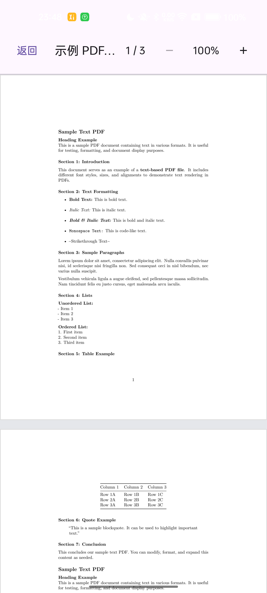
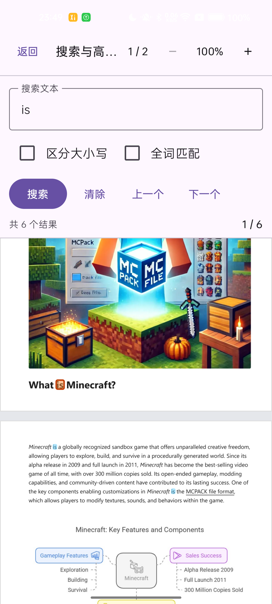

# Using PDF Viewer

`pdf-viewer` is the Compose Multiplatform UI layer. It displays an open
`PdfDocument` as a lazy, vertically scrolling list and renders pages again as
the zoom level changes.

<p align="center">
  
  
</p>

## Dependency

```kotlin
kotlin {
    sourceSets {
        commonMain.dependencies {
            implementation("io.github.limuyang2:pdf-viewer:0.4.1")
        }
    }
}
```

`pdf-core` is an API dependency of `pdf-viewer` and is selected transitively.

The platform-specific PDFium setup described in
[Using PDF Core](using-pdf-core.md#platform-specific-setup) still applies.

## Open and display a document

Open the document outside `PdfView`, keep it in Compose state, and close it
when it leaves the composition:

```kotlin
import androidx.compose.foundation.layout.Box
import androidx.compose.foundation.layout.fillMaxSize
import androidx.compose.material3.CircularProgressIndicator
import androidx.compose.material3.Text
import androidx.compose.runtime.Composable
import androidx.compose.runtime.DisposableEffect
import androidx.compose.runtime.LaunchedEffect
import androidx.compose.runtime.getValue
import androidx.compose.runtime.mutableStateOf
import androidx.compose.runtime.remember
import androidx.compose.runtime.setValue
import androidx.compose.ui.Alignment
import androidx.compose.ui.Modifier
import io.github.limuyang2.pdf.core.PdfDocument
import io.github.limuyang2.pdf.core.PdfSource
import io.github.limuyang2.pdf.core.PdfViewer
import io.github.limuyang2.pdf.viewer.PdfView
import io.github.limuyang2.pdf.viewer.rememberPdfViewState
import kotlinx.coroutines.CancellationException

@Composable
fun PdfScreen(
    pdfBytes: ByteArray,
    modifier: Modifier = Modifier,
) {
    var document by remember(pdfBytes) {
        mutableStateOf<PdfDocument?>(null)
    }
    var failure by remember(pdfBytes) {
        mutableStateOf<Throwable?>(null)
    }
    val viewState = rememberPdfViewState()

    LaunchedEffect(pdfBytes) {
        try {
            document = PdfViewer.open(PdfSource.Bytes(pdfBytes))
        } catch (cancellation: CancellationException) {
            throw cancellation
        } catch (error: Throwable) {
            failure = error
        }
    }

    val currentDocument = document
    DisposableEffect(currentDocument) {
        onDispose {
            currentDocument?.close()
        }
    }

    when {
        currentDocument != null ->
            PdfView(
                document = currentDocument,
                state = viewState,
                modifier = modifier.fillMaxSize(),
            )
        failure != null ->
            Text(checkNotNull(failure).message ?: "Could not open PDF")
        else ->
            Box(
                modifier = modifier.fillMaxSize(),
                contentAlignment = Alignment.Center,
            ) {
                CircularProgressIndicator()
            }
    }
}
```

The caller owns `PdfDocument`. `PdfView` never closes it, but it does close
temporary `PdfBitmap` objects after converting them into Compose images.

## Configure PdfView

```kotlin
PdfView(
    document = document,
    state = state,
    modifier = Modifier.fillMaxSize(),
    pageSpacing = 12.dp,
    pagePadding = 8.dp,
    pageColor = Color.White,
    maxRenderDimension = 4096,
    maxZoom = 5f,
    gestureZoomEnabled = true,
)
```

Important parameters:

| Parameter | Default | Description |
| --- | --- | --- |
| `state` | `rememberPdfViewState()` | Scroll position, zoom, current page, and render cache. |
| `pageSpacing` | `12.dp` | Vertical space between pages. |
| `pagePadding` | `0.dp` | Padding around the page list. |
| `pageColor` | `Color.White` | Background color behind a rendered page. |
| `pageBorder` | 1 dp translucent border | Set to `null` to remove page borders. |
| `maxZoom` | `4f` | Maximum visual zoom multiplier. Must be finite and at least `1f`. |
| `gestureZoomEnabled` | `true` | Enables or disables multi-touch zoom. Programmatic zoom remains available. |
| `maxRenderDimension` | `4096` | Maximum full-page/preview bitmap dimension; does not cap the virtual tile canvas. |
| `renderOptions` | `PdfViewRenderOptions()` | `Auto`, `FullPage`, or `Tiled` rendering policy. |
| `searchHighlightStyle` | yellow matches, orange selection | Fill, stroke, corner radius, and padding for search results and the selected result. |

`maxZoom` and `maxRenderDimension` solve different problems:

- `maxZoom` limits how far the page can grow on screen.
- `maxRenderDimension` limits bitmap memory and rendering cost.

With `FullPage`, enlarging beyond `maxRenderDimension` scales the capped bitmap.
`Auto` and `Tiled` can render visible tiles at higher resolution.

## Gesture behavior

- A single pointer scrolls the document vertically or horizontally.
- A two-pointer gesture changes zoom.
- Pan deltas are ignored while two-pointer zoom is active to avoid jitter and
  competition with the scroll containers.
- When `gestureZoomEnabled` is `false`, `PdfViewState.updateZoom()` and
  `zoomBy()` still work.

## Control the viewer state

```kotlin
val state =
    rememberPdfViewState(
        initialPage = 0,
        initialZoom = 1f,
    )
```

Available controls:

```kotlin
state.updateZoom(2f)
state.zoomBy(1.25f)
state.scrollToPage(pageIndex = 4)
state.animateScrollToPage(pageIndex = 4)
state.clearRenderCache()
```

`state.currentPage` is the zero-based index of the first visible page.
`state.zoom`, the lazy-list position, and horizontal scroll position are
saveable. The active `PdfView.maxZoom` also constrains programmatic zoom.

Call the suspend scrolling functions from a coroutine:

```kotlin
val scope = rememberCoroutineScope()

Button(
    onClick = {
        scope.launch {
            state.animateScrollToPage(10)
        }
    },
) {
    Text("Page 11")
}
```

## Search and highlighting

Start a search through `PdfViewState`. Results are added page by page and are
automatically highlighted by a `PdfView` bound to the same state:

```kotlin
val state = rememberPdfViewState()

LaunchedEffect(document, query, matchCase, matchWholeWord) {
    state.search(
        document = document,
        query = query,
        options =
            PdfSearchOptions(
                matchCase = matchCase,
                matchWholeWord = matchWholeWord,
            ),
    )
}

PdfView(
    document = document,
    state = state,
)
```

An empty query clears the search. Progress and results are available from:

```kotlin
val status = state.searchStatus
val results = state.searchResults
val selectedIndex = state.selectedSearchResultIndex
val selectedResult = state.selectedSearchResult
```

`searchStatus` is `Idle`, `Searching`, `Completed`, or `Failed`. `Searching`
contains the completed and total page counts; `Failed` retains the original
exception. Coroutine cancellation is rethrown and clears that unfinished
search.

The first result becomes selected. An application can provide previous and
next controls and scroll to the selected result's page:

```kotlin
scope.launch {
    state.selectNextSearchResult()?.let { result ->
        state.animateScrollToSearchResult(result)
    }
}

scope.launch {
    state.selectPreviousSearchResult()?.let { result ->
        state.animateScrollToSearchResult(result)
    }
}
```

Both navigation methods wrap by default. Pass `wrapAround = false` to stop at
either end. Use `selectSearchResult(index)` to select an exact result or
`clearSearch()` to clear the search.

`animateScrollToSearchResult()` uses the match bounds, page rotation, and
current zoom to position the result inside the viewport. It also adjusts the
horizontal position when a zoomed page is wider than the viewport. By default,
the result is placed approximately 40% from the top. Customize this with
`PdfSearchScrollAlignment`:

```kotlin
state.animateScrollToSearchResult(
    result = result,
    alignment =
        PdfSearchScrollAlignment(
            verticalFraction = 0.5f,
            horizontalFraction = 0.5f,
        ),
)
```

Use `scrollToSearchResult()` for immediate positioning without animation.
Both functions require a `PdfView` bound to the state that has completed at
least one layout pass.

Configure normal and selected highlights with `searchHighlightStyle`:

```kotlin
PdfView(
    document = document,
    state = state,
    searchHighlightStyle =
        PdfSearchHighlightStyle(
            match =
                PdfSearchHighlightDecoration(
                    fillColor = Color.Yellow.copy(alpha = 0.3f),
                    cornerRadius = 2.dp,
                    padding = 1.dp,
                ),
            selectedMatch =
                PdfSearchHighlightDecoration(
                    fillColor = Color(0x6681D4FA),
                    strokeColor = Color(0xFF0277BD),
                    strokeWidth = 2.dp,
                    cornerRadius = 2.dp,
                ),
        ),
)
```

Search results belong to a specific document and are not written to the
`rememberPdfViewState` saved state. Binding another document clears them. The
viewer uses the result rectangle for precise positioning. Results near the
beginning or end of the document may not reach the requested alignment because
the scroll range is clamped to the document bounds.

## Loading and page errors

`pageLoadingContent` is displayed while page information or imagery is being
loaded. `pageErrorContent` replaces the built-in page error message:

```kotlin
PdfView(
    document = document,
    pageLoadingContent = { pageIndex ->
        CircularProgressIndicator()
    },
    pageErrorContent = { pageIndex, error ->
        Text("Page ${pageIndex + 1}: ${error.message}")
    },
    onPageError = { pageIndex, error ->
        println("PDF page $pageIndex failed: $error")
    },
)
```

`onPageError` is for reporting the failure; `pageErrorContent` controls its UI.
Document-opening errors occur before `PdfView` is created and must be handled
by the caller.

## Link handling

The default link behavior is:

- internal destinations scroll to the destination page;
- URI links open with Compose `LocalUriHandler`;
- remote-document and unsupported actions are ignored.

`onLinkClick` runs before the default behavior. Return `true` to consume the
link:

```kotlin
PdfView(
    document = document,
    onLinkClick = { link ->
        println("PDF link: $link")
        false
    },
    onUriLinkClick = { uri ->
        println("Open URI with the application: $uri")
    },
    onLinkError = { pageIndex, link, error ->
        println("Link on page $pageIndex failed: $link, $error")
    },
)
```

Pass `onUriLinkClick = null` to ignore URI links.

## Rendering and caching

`Auto` (the default) keeps a full-page preview, capped at a requested width of
1024 pixels and by `maxRenderDimension`. When the settled target resolution
exceeds the preview, visible tiles progressively cover it. `Tiled` requests
visible tiles at every settled resolution. Both modes fall back to the existing
full-page path if the core backend does not support tiles.

```kotlin
PdfView(
    document = document,
    state = viewState,
    renderOptions = PdfViewRenderOptions(mode = PdfRenderMode.Auto),
)
```

The view fits page width at `1f` zoom. During a pinch gesture it scales existing
images; after the gesture settles it selects a discrete rendering resolution.
Scrolling updates the visible tile set without changing the page's pixel grid.
Tiles contain up to 512 × 512 content pixels plus a one-pixel sampling border.
Only visible tiles are requested; neighboring-tile prefetch is not enabled.

One view-level worker prioritizes previews, merges identical requests and drops
queued requests when they leave the viewport. A completed in-flight request may
still enter the document-bound cache. Search highlights and link hit testing
remain in page display coordinates, independent of tile resolution. Tile
failures invoke `onPageError` while leaving the preview visible.

Preview and tile caches have separate nominal pixel budgets of 32 MiB each.
The budget is not a hard process-memory limit: displayed images, one oversized
full-page entry, native buffers and platform image copies can add memory.
Binding another document or calling `clearRenderCache()` clears both caches;
currently displayed images can remain referenced by the UI until replaced.
The caller retains ownership of the document. Temporary core bitmaps are closed
after conversion, including during cancellation.

## Viewer limitations

The current viewer does not provide:

- selectable text;
- built-in search input or search-navigation controls;
- bookmarks or thumbnail navigation;
- form interaction.

These UI limitations are separate from the lower-level capabilities exposed
by `pdf-core`.

[Back to README](../README.md)
